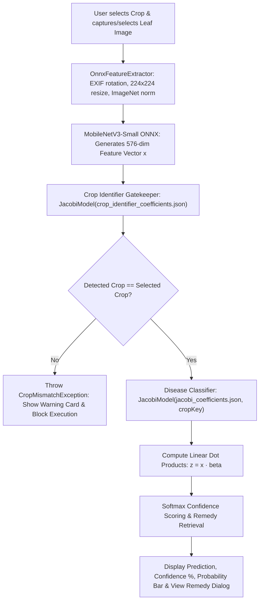

# TinyBayes-App: Context & Architecture Guide

This document is the **single source of truth** for the `TinyBayes-App` Android application repository. Any engineer or AI agent reading this file will understand the entire application architecture, on-device Edge-AI inference pipeline, asset management, and UI implementation in one pass.

---

## 1. Application Overview

**TinyBayes-App** is a native Android application built with **Jetpack Compose** and **Kotlin** that provides instantaneous, 100% offline plant disease diagnosis and agronomic remedy recommendations.

* **Repository**: [`TinyBayes-App`](file:///c:/Users/priya/Downloads/ok/TinyBayes-App)
* **Companion ML Repo**: [`TinyBayes-ML`](file:///c:/Users/priya/Downloads/ok/TinyBayes-ML)
* **Inference Type**: 100% On-Device Edge-AI (Zero network requests, zero server dependencies).
* **Latency**: Under **40 ms** on standard Android mobile processors.
* **Storage Footprint**: Total model weight footprint is **< 4.5 MB**.

---

## 2. On-Device Model Asset Layout

All model weights and mathematical coefficients are packaged directly inside the app assets at [`app/src/main/assets/models/`](file:///c:/Users/priya/Downloads/ok/TinyBayes-App/app/src/main/assets/models):

```text
app/src/main/assets/models/
├── mobilenet_v3_small_features.onnx       # Backbone feature extractor (274 KB)
├── mobilenet_v3_small_features.onnx.data  # ONNX external tensor weights (3.68 MB)
├── crop_identifier_coefficients.json      # Gatekeeper crop verification model (75 KB)
└── jacobi_coefficients.json               # UNIFIED disease model + remedies (479 KB)
```

### Model Files Breakdown:
1. **`mobilenet_v3_small_features.onnx`** (ONNX Runtime):
   * Converts any raw $224 \times 224$ RGB image into a rich 576-dimensional semantic botanical feature vector $\mathbf{x} \in \mathbb{R}^{576}$.
2. **`crop_identifier_coefficients.json`**:
   * Evaluates the 576-dim vector against the 5 primary crops: Cocoa, Cotton, Potato, Rice, Tomato.
   * Acts as a strict gatekeeper: blocks invalid inputs before disease diagnosis.
3. **`jacobi_coefficients.json`**:
   * Contains all **27 active disease classes** across all 5 crops in a single unified schema.
   * Each class entry embeds both the 576 float coefficients (`"beta"`) and comprehensive agricultural remedies (`"remedy"`).

---

## 3. End-to-End Inference Pipeline

When a user selects a crop and takes or uploads a leaf photo:



### Pipeline Steps in Detail:
1. **Image Preprocessing** ([`OnnxFeatureExtractor.kt`](file:///c:/Users/priya/Downloads/ok/TinyBayes-App/app/src/main/java/com/example/tinybayes/model/OnnxFeatureExtractor.kt)):
   * Resolves EXIF camera orientation using `ExifInterface` so sideways/inverted photos are properly oriented.
   * Direct bilinear resize to $224 \times 224$ (full-image preservation without cropping away diseased margins).
   * ImageNet normalization: $\frac{\text{pixel} / 255.0 - \text{mean}}{\text{std}}$ with $\mu=[0.485, 0.456, 0.406]$ and $\sigma=[0.229, 0.224, 0.225]$.
   * Channel transpose to NCHW float tensor: `[1, 3, 224, 224]`.
2. **Crop Verification Check** ([`TinyBayesClassifier.kt:L61-L67`](file:///c:/Users/priya/Downloads/ok/TinyBayes-App/app/src/main/java/com/example/tinybayes/inference/TinyBayesClassifier.kt#L61-L67)):
   * Gatekeeper evaluates features against all 5 crops.
   * If detected crop does not match the user's selected crop (`!cropCheck.className.equals(crop, ignoreCase = true)`):
     * Throws `CropMismatchException`.
     * UI catches this and renders an error card: *"Crop Mismatch: This image does not appear to belong to a [crop] leaf. Kindly select the correct leaf image."*
     * **Design Decision**: The app strictly blocks diagnosis and does not prompt automated cross-crop switching.
3. **Jacobi-DMR Prediction** ([`JacobiModel.kt:L70-L119`](file:///c:/Users/priya/Downloads/ok/TinyBayes-App/app/src/main/java/com/example/tinybayes/model/JacobiModel.kt#L70-L119)):
   * Retrieves the crop's section from `models/jacobi_coefficients.json`.
   * Computes dot products: $z_c = \sum_{i=0}^{575} x_i \cdot \beta_{c,i}$.
   * Stabilized softmax: $P(c) = \frac{\exp(z_c - z_{\max})}{\sum_j \exp(z_j - z_{\max})}$.
   * Identifies highest probability class and retrieves embedded remedy text.

---

## 4. Key Kotlin Source Files

* **[`MainActivity.kt`](file:///c:/Users/priya/Downloads/ok/TinyBayes-App/app/src/main/java/com/example/tinybayes/MainActivity.kt)**:
  * Pure Jetpack Compose single-activity interface.
  * Crop selector tabs (Cocoa, Cotton, Potato, Rice, Tomato).
  * Portrait orientation locked via AndroidManifest (`screenOrientation="portrait"`).
  * Auto-deselection behavior: Changing the active crop automatically clears the current image and previous diagnosis.
  * Diagnosis Card: Clean disease name formatting (replaces underscores with spaces), confidence progress indicator, and sorted probability list.
  * **"View Recommended Remedy" Dialog**: Parses structured remedy text into separate cards for Symptoms, Cultural/Agronomic Control, Biological Control, and Chemical Control.
* **[`TinyBayesClassifier.kt`](file:///c:/Users/priya/Downloads/ok/TinyBayes-App/app/src/main/java/com/example/tinybayes/inference/TinyBayesClassifier.kt)**:
  * Top-level inference coordinator.
  * Loads `cropIdentifierModel` and maps all 5 crop models (`Cocoa`, `Cotton`, `Potato`, `Rice`, `Tomato`) to `models/jacobi_coefficients.json`.
* **[`JacobiModel.kt`](file:///c:/Users/priya/Downloads/ok/TinyBayes-App/app/src/main/java/com/example/tinybayes/model/JacobiModel.kt)**:
  * Universal parser supporting both root JSON structures and nested crop sections (`cropKey`).
  * Executes the dot product matrix operations and returns `PredictionResult`.
* **[`OnnxFeatureExtractor.kt`](file:///c:/Users/priya/Downloads/ok/TinyBayes-App/app/src/main/java/com/example/tinybayes/model/OnnxFeatureExtractor.kt)**:
  * Manages the ONNX Runtime session and memory buffers for `mobilenet_v3_small_features.onnx`.

---

## 5. Agricultural Remedy Catalog

In the mobile app runtime, remedies are embedded directly inside the [`jacobi_coefficients.json`](file:///c:/Users/priya/Downloads/ok/TinyBayes-App/app/src/main/assets/models/jacobi_coefficients.json) asset, parsed on the fly, and rendered in the diagnosis sheet.

The full human-readable agronomic reference guide for all 27 active diseases is maintained in the ML repository:
* [`CROP_DISEASE_REMEDIES.md`](file:///c:/Users/priya/Downloads/ok/TinyBayes-ML/CROP_DISEASE_REMEDIES.md)

Contains field dosages, commercial pesticide active ingredients (e.g. Hexaconazole, Mancozeb, Azoxystrobin), cultural hygiene protocols, and viral vector sanitation steps for farmers and agronomists.
